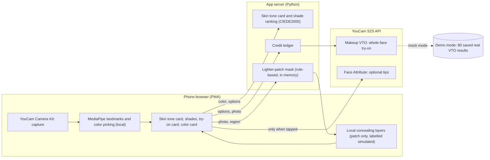

# Good Glow Try-On

Independent hackathon entry, not affiliated with Perfect Corp.; general information only, not medical advice (see [NOTICE.md](NOTICE.md)).

A try-on web app (PWA) built for the **YouCam API Skin AI & eCommerce VTO hackathon, eCommerce VTO track**. It is designed
for two groups who rarely see themselves in beauty tech (people with albinism and people with vitiligo; the app screens use neutral descriptions of needs instead of condition names):

- people with **very light skin, brows and lashes** (albinism; many are also light-sensitive), and
- people whose skin has **lighter patches and uneven tone** (vitiligo).

The project has **not yet been tested with the people it is for**. Thank you to the people and photographers who make photos of themselves publicly available under open licences. Clear photos of people with albinism or vitiligo are scarce, and frontal ones scarcer. For one example the only suitable photo was a side view, so we used an AI-generated frontal illustration made from it, to demonstrate the method. It is not the person's original photo and is labelled Simulated on screen. The people in these photos did not take part in this project and do not endorse it. Demo photos are public stock photos of models; they are not users and do not endorse it. All images are simulated; sources and limits are in [`demo/SOURCES.md`](demo/SOURCES.md) and [`evidence/README.md`](evidence/README.md).

## At a glance: what is real and what is replayed

- **Live mode** (`python3 -B app/server.py`, needs your own YouCam key) calls the YouCam S2S REST API for real: file upload, Makeup VTO task, polling, result download, all behind a credit ledger. Request and response details: [`docs/YOUCAM_API_EXAMPLES.md`](docs/YOUCAM_API_EXAMPLES.md).
- **Demo mode** (`--mock`, what a public demo runs) needs no key and no credits. It shows pictures saved from **80 real YouCam Makeup VTO calls** made on the demo photos (their options, times and checksums are in `demo/replay/*/exact/index.json`), exact for the recorded combinations and the closest otherwise. Every screen says it is a demo.
- **Local code** does what YouCam's try-on cannot: the lighter-patch mask and patch concealing (it has no region parameter), the skin tone card and shade ranking, and the evidence you can rerun.



One app, two entry points. Take a mirror-like selfie, and the app:

1. picks your skin tone on your phone; for the second entry point, the lighter-patch mask is computed by the app server from your photo, held in memory only and not stored (the browser has a fallback when the server is unreachable);
2. **matches the tone to a 10-level × cool/neutral/warm skin tone card first, then ranks shades** of a catalog by card level and undertone, then by color difference;
3. tries on the whole face through **YouCam Makeup VTO** (base, brows, lashes, blush, lips, contour; YouCam smoothing is fixed at 0; keeping your look as it is is always the first option). Makeup VTO has no region parameter, so concealing only on a patch is done by our local code and labelled *simulated*;
4. gives a care card (moisturize, protect, then makeup) with the shades, which you can show to a beauty advisor or save as an image.

It only adds makeup and does not smooth the skin through YouCam (smoothing 0); one demo final (very-light-skin Example B) also has a local soft-focus pass that is labelled on the page. Looks are labelled *simulated*, and the app never shows a before/after
"improvement". Large type and a dark theme are built in; if the light is too bright, the screen can be switched to dark. Auto-capture uses the YouCam Camera Kit and the live camera preview needs HTTPS; it was tested on one Android phone, while on a plain-HTTP local server only the album option is available. Photos under 640 px on the short side are rejected (the Camera Kit returns about 680 x 1080 on a phone).

## Two ways to try it: the demo page and the judge test version

The same site and the same code serve both. The server decides for each request, from a signed cookie, which one you get ([operating modes](docs/assets/diagrams/03-operating-modes.png), [request flow](docs/assets/diagrams/04-tryon-request.png)).

| | **Demo page** (default) | **Judge test version** |
|---|---|---|
| Who it is for | Anyone, no sign-in | Judges and the owner, with the username and password given in the testing instructions |
| How to get there | Just open the site | Tap **Judge sign-in** in the banner at the top, enter the username and password; the same banner link signs you out (the page `/judge` does the same) |
| Banner says | "Demo mode: replaying saved results from real YouCam calls · no credits used" | "Live mode: n/m try-ons used this time" |
| YouCam calls | None. It shows pictures saved from **80 real YouCam Makeup VTO calls**, exact for the choices that were recorded and the closest otherwise, labelled simulated | Real calls: Makeup VTO (1 credit), optional Face Attribute (10 credits) |
| Your own photo | Comes back unchanged with a demo note; the local steps (skin tone card, shade ranking, lighter-patch mask) still work | Sent to YouCam for the try-on; you see the real result |
| Limits | None needed, it costs nothing | 5 live calls per server start and 30 credits in total; at the limit the server refuses live calls, and signing out returns to the demo page |
| Why two | A public site must not be able to spend credits | Judges can verify that the real API calls work |

If the four settings that switch live mode on are missing (live switch, YouCam key, judge username, judge password), the site is the demo page only and there is no sign-in. Settings live in the hosting platform, never in this repository ([SECURITY.md](SECURITY.md)).

## Architecture

Thirteen diagrams (context and deployment, components, operating modes, try-on request, skin tone to shade, uneven-tone pipeline, capture checks, credit ledger, mapping tables, real technique vs simulation, local tools, evidence pipeline, translation pipeline) are in [`docs/ARCHITECTURE.md`](docs/ARCHITECTURE.md). How it was built (tools, methods, review rounds, and a friction log of what we hit in the YouCam APIs) is in [`docs/PROCESS.md`](docs/PROCESS.md); what we protect and how is in [`THREAT_MODEL.md`](THREAT_MODEL.md); every number in this README is checked against the code and data in CI (`tools/check_claims.py`). The layer-by-layer comparison between real application technique and our simulation is in [`docs/LAYERS_TECHNIQUE_VS_SIMULATION.md`](docs/LAYERS_TECHNIQUE_VS_SIMULATION.md); the local tools are in [`docs/TOOLS_AND_USAGE.md`](docs/TOOLS_AND_USAGE.md).


## Quick start (no API key needed)

Requirements: Python 3.10+ and a modern mobile or desktop browser.

```bash
python3 -m pip install -r requirements.txt
python3 -B app/server.py --mock
```

Open <http://127.0.0.1:8787>. In `--mock` mode **no YouCam call is made and no credits are used**: the demo photos show pictures saved earlier from real
YouCam calls (stored under `demo/`), the picture saved for exactly your choices when one was recorded (80 combinations on the demo photos; re-recorded against the
current presets), otherwise the closest saved picture (the screen says so), or a pre-computed final look; your own photos come back unchanged with a "Demo mode | simulated" strip. The in-app
layer-by-layer view is not meaningful in demo mode (most layers show the original photo). Tests: `python3 -B -m unittest discover -s tests`.

**Language.** The app follows the browser language (Chinese or English). Force English with `http://127.0.0.1:8787/?lang=en`, or use the
language button on the start page. All server messages are translated too.

**Phone.** Same Wi-Fi, then `python3 -B app/server.py --mock --host 0.0.0.0` and open `http://<computer-LAN-IP>:8787`.
Browsers need HTTPS for the live camera preview; without it use the album button, which runs the whole flow.

## Live mode (your own YouCam key)

```bash
export YOUCAM_API_KEY=...        # or put one line YOUCAM_API_KEY=... in .env (API Key only; never commit it)
python3 -B app/server.py --max-calls 20 --budget-cap 60
```

The key stays on the server and never reaches the browser. A credit ledger reserves credits first and records them only when YouCam reports
success; `--max-calls` limits the number of Makeup VTO try-ons in one run, and `--budget-cap` limits the total credits across runs (Face Attribute calls, 10 credits each, count against the budget cap only). Makeup VTO costs 1 credit per try-on.

## Evidence page: how a look is built

[`evidence/`](evidence/README.md) shows how a look is built, layer by layer, and what the online app can and cannot do: four examples, each as a cumulative
slider (11, 4, 17 local layers and stage images only, plus the YouCam try-on steps), a heat map of what each layer changed, the technique used per layer, the
technology list, and the cross-checks. It lives in the repository only; the app does not link to it and the container image does not include it. Every image is labelled Simulated. Data: `evidence/process.json`, regenerated from local run folders by
`tools/export_process_demo.py` (the run folders are not in the repository).

## Shade data

This repository ships a **fictional demo catalog** (`app/catalog.json`: brands, shades and colors are all made up). The home page numbers
and the shade page notes come from the catalog that is actually loaded (`/api/status`), so a fresh clone shows the demo catalog.
The code can load an authorized brand shade file (`app/partner_shades_official.json`) and prefers it when present; such data is not
part of this repository. Recordings and screenshots for the public (video, Devpost) always use `--catalog demo`, the fictional catalog, so no third-party brand name or brand shade code
appears. `--brand-alias` (letter aliases such as Brand M, product names turned into categories, shade names dropped, codes kept) is for local
checks only and is not used for public material.

## How the pieces fit

| Where | What | Notes |
|---|---|---|
| Phone browser | Face landmarks (MediaPipe), capture checks, color picking, local concealer layers (OpenCV.js), fallback patch detection | the photo is not uploaded for these; the primary lighter-patch mask is computed on the app server (in memory, not stored) |
| `app/server.py` | serves `web/`, proxies YouCam Makeup VTO / Face Attribute, local color matching, lighter-patch mask (`app/patch_detect.py`) | `--mock` has no YouCam client |
| `app/skin_card.py`, `app/color_engine.py` | skin tone card, CIEDE2000 matching, shade plans | all local, no credits |
| `app/i18n_srv.py`, `web/i18n/en.js` | English for server messages and for the UI, built from `docs/i18n/zh_en_map.csv` | Chinese output is unchanged |
| `demo/` | public demo photos, saved results of real YouCam calls, and an AI-generated expected-look image (labelled Simulated) | sources and licences in `demo/SOURCES.md` |

## Where YouCam is called

The YouCam REST client is `tools/noise_test.py` (class `YouCamClient`: bearer key from the `YOUCAM_API_KEY` environment variable, file upload, task polling, retries); `app/server.py` calls it and wraps every call in the credit ledger (`app/budget.py`).

| Feature | Endpoints (YouCam S2S API) | Code | Credits |
|---|---|---|---|
| Makeup VTO (try-on) | `POST /s2s/v2.0/file` then `POST /s2s/v2.0/task/makeup-vto`, poll `GET /s2s/v2.0/task/makeup-vto/{id}` | `app/server.py` (`_render_live`), request bodies from `app/looks.py` | 1 per call |
| Face Attribute (optional tips, only when the user taps) | `POST /s2s/v2.0/task/face-attr-analysis`, poll `GET …/{id}` | `app/server.py`, rules in `app/face_rules.py` | 10 per call |
| Camera Kit (capture, auto-capture) | browser SDK loaded from the YouCam CDN | `web/app.js` | none |
| Skin Analysis HD (12 units), Skin Tone Analysis (20 units) | used offline during development only | `tools/noise_test.py` (Skin Analysis HD), `tools/youcam_probe.py` (both) | 12 / 20 |

In `--mock` mode none of these are called: pictures saved from real calls in `demo/replay/` are shown: the one recorded for your exact choices when it exists, otherwise the closest.

## Privacy

Photos are processed in memory (orientation fix, resize, re-encode without EXIF) and dropped after the try-on; results go straight back to the
browser. Face landmarks run in the browser (the MediaPipe models and scripts are fetched from public CDNs at run time, and the YouCam Camera Kit script from the YouCam CDN, so a visit loads third-party code from those hosts); the lighter-patch mask is computed on the app server, in memory. In live mode the photo is sent to YouCam for the try-on; in demo mode it is not. Tone, shade matching and the care card are computed locally. Only light fingerprints (brightness and
colour-temperature numbers) and preferences are kept in the browser.

## Licence

Code: MIT (see `LICENSE`). Photos in `demo/` follow their own licences (`demo/SOURCES.md`). The app uses the YouCam API by Perfect Corp.; bring your own key.
