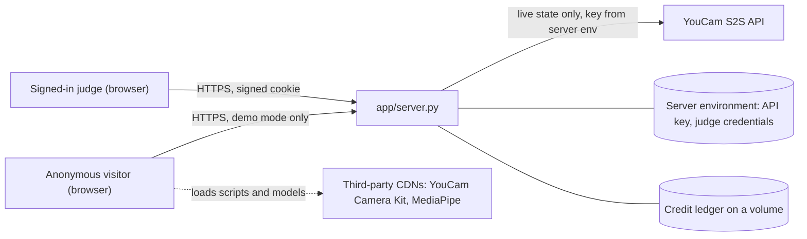

# Threat model

Scope: the web app and server in this repository, as deployed in demo mode (open to everyone) and in live mode (a signed-in judge, real YouCam calls). This is a hackathon project: the model says what we protect, what we did about each threat, where the evidence is, and what remains open. Reporting a problem: [SECURITY.md](SECURITY.md).

## Assets

| Asset | Why it matters |
|---|---|
| YouCam API key | Spends credits and acts as the project's account; must never reach a browser, a log or the repository |
| Credit balance | A finite budget; public use must not be able to drain it |
| Face photos | Sensitive personal images; kept only for the request |
| Judge credentials | Open the only path to real YouCam calls |
| Availability | A small server must stay up under a bad request or a crowd |

## Trust boundaries

## Threats and what we did

| # | Threat | Mitigation | Evidence | Open |
|---|---|---|---|---|
| T1 | API key leaks to the browser, logs or Git | The key is read from the server environment only; `/api/status` returns a boolean `key_present`; the image contains no key; the full history and tree are scanned with gitleaks; a redirect to another host drops the `Authorization` header; `--api-base` accepts only YouCam hosts or localhost | `tests/test_server_limits.py` (`CredentialGuardTests`), `tools/noise_test.py` (`_SafeRedirect`), `app/server.py` (`check_api_base`), `tests/test_deploy.py` | A key in the platform's settings is only as safe as that account |
| T2 | The public drains the credits | Demo mode is the default and calls nothing; live calls exist only for a signed-in judge; `--max-calls` per start and `--budget-cap` across starts; the ledger reserves first and records only on success; a persistent volume keeps the ledger across redeploys | `app/budget.py`, `tests/test_deploy.py`, `tests/test_judge_auth.py` | If the volume is not mounted, the cap restarts at each deploy (the per-start limit still holds) |
| T3 | Guessing the judge password | Password of at least 10 characters; constant-time comparison; sign-in locks for a minute after six wrong attempts; the sign-in cookie is HttpOnly, SameSite=Lax, `Secure` behind HTTPS, signed with a key generated at each start | `app/judge_auth.py`, `tests/test_judge_auth.py` | The lock is global, so an attacker can also lock the judge out for a minute |
| T4 | Photos stored or leaked | Photos are processed in memory (orientation fix, resize, re-encode without EXIF) and dropped; nothing is written to disk; the lighter-patch mask is in memory; landmarks and color picking run in the browser | `app/server.py` (`prepare_vto_image`), README "Privacy" | In live mode the photo goes to YouCam by design; the browser loads third-party scripts |
| T5 | Oversized or malicious uploads | Declared pixel count above 40 million is refused before decoding; only JPEG, PNG and WebP; 16 MB body limit; socket timeout; 64 concurrent connections; at most two heavy requests at once, the rest wait 8 s and get HTTP 503 | `tests/test_server_limits.py`, `tests/test_deploy.py` | No per-visitor rate limit |
| T6 | Clickjacking and content sniffing | `X-Frame-Options: DENY`, `X-Content-Type-Options: nosniff`, `Referrer-Policy: no-referrer` on every response | `tests/test_server_limits.py` | No Content-Security-Policy yet |
| T7 | Path traversal in static files | A request path must resolve inside `web/` | `app/server.py` (`do_GET`) | |
| T8 | A compromised third-party script | MediaPipe is loaded from a pinned version; the Camera Kit comes from the YouCam CDN; no secrets live in the page | `web/face_auto.js`, `web/app.js` | Scripts are not self-hosted and have no subresource integrity; a compromise there could read the photo on screen |
| T9 | Misleading pictures | Every generated image is labelled *Simulated*; demo mode says it replays saved results; no before/after "improvement" is shown | `tests/test_demo_fallback_and_hygiene.py` | |
| T10 | Medical misuse | The app gives general care and sun-protection tips only and tells people to see a dermatologist about any new or changing spot | [NOTICE.md](NOTICE.md) | The project has not been tested with the people it is for |
| T11 | Brand data or personal data in the public build | The image and the repository carry only a fictional shade catalog; a pre-publication scan checks for brand names, shade codes, e-mail addresses and secret patterns | `.dockerignore`, `tests/test_deploy.py` | |

## Out of scope

Denial of service from a large botnet, a compromised hosting account, a malicious browser extension, and side channels on the photo while it is in server memory.

## Review

The hardening above came from independent review rounds (a security review, a key-and-API review and a claims review run in parallel before the first publication), each finding was fixed with a test, and the evidence column points at the test. The claims review is also automated: `tools/check_claims.py` runs in CI and fails when a number in the documentation stops matching the code.
