# Architecture

How Good Glow Try-On is put together, which local tools are used to build and verify it, and how the mapping tables were used to find where our makeup simulation differs from real application technique. All diagrams are [Mermaid](https://mermaid.js.org/) and render on GitHub. Names in `code font` are files in this repository unless said otherwise.

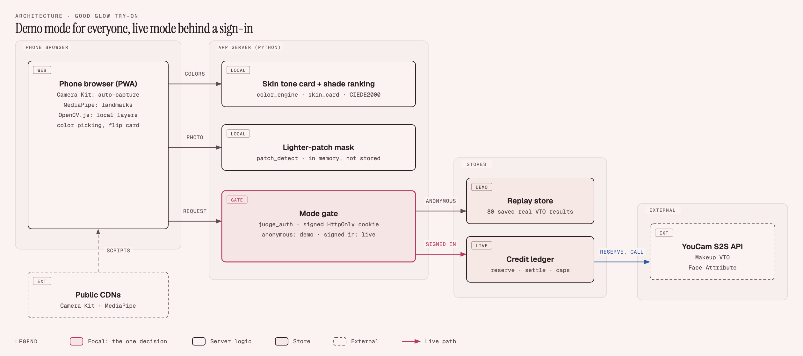

Contents: [1 Context and deployment](#1-context-and-deployment) · [2 Components](#2-components) · [3 Operating modes](#3-operating-modes) · [4 Try-on request](#4-try-on-request) · [5 Skin tone to shade](#5-skin-tone-to-shade) · [6 Uneven-tone pipeline](#6-uneven-tone-pipeline) · [7 Capture and photo checks](#7-capture-and-photo-checks) · [8 Credit ledger](#8-credit-ledger) · [9 Mapping tables](#9-mapping-tables) · [10 Real technique vs simulation](#10-real-technique-vs-simulation) · [11 Local tools](#11-local-tools) · [12 Evidence pipeline](#12-evidence-pipeline) · [13 Translation pipeline](#13-translation-pipeline)

## 1 Context and deployment

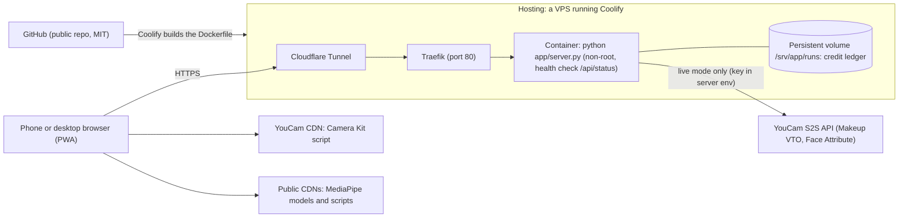

- The image holds `app/`, `web/`, `demo/` and `tools/noise_test.py` only. It contains no API key, no brand data and no evidence page.
- The key, the judge sign-in and the call limits are environment variables set on the platform, never in the repository ([SECURITY.md](../SECURITY.md)).

## 2 Components

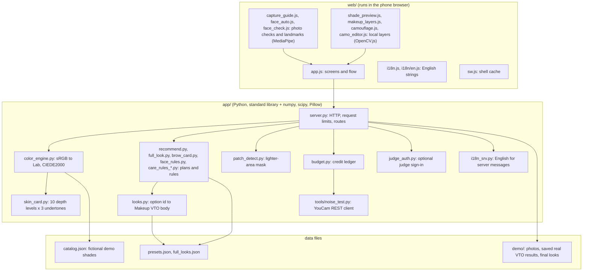

## 3 Operating modes

The public site is open to everyone in demo mode. Real YouCam calls exist only for a signed-in judge, and only when the platform provides all four settings.

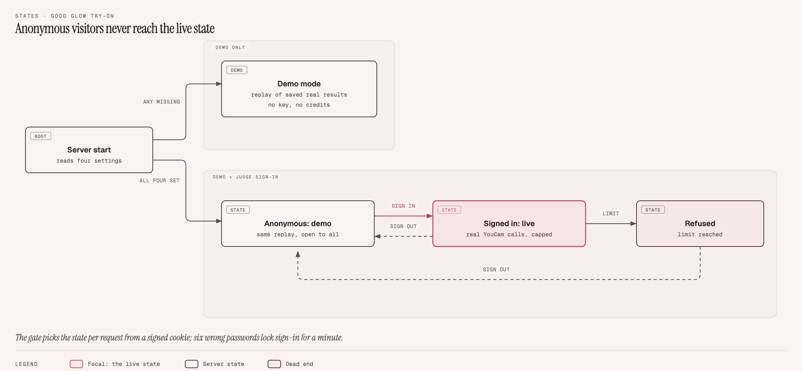

Mermaid source

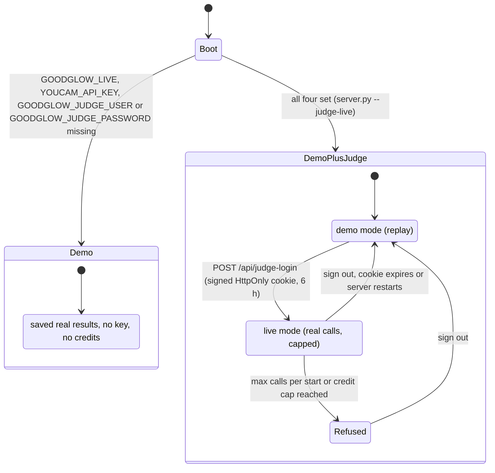

Wrong passwords lock sign-in for a minute after six failures. Anonymous requests never reach the live state: `Handler._pick_state` chooses the state per request from the cookie.

## 4 Try-on request

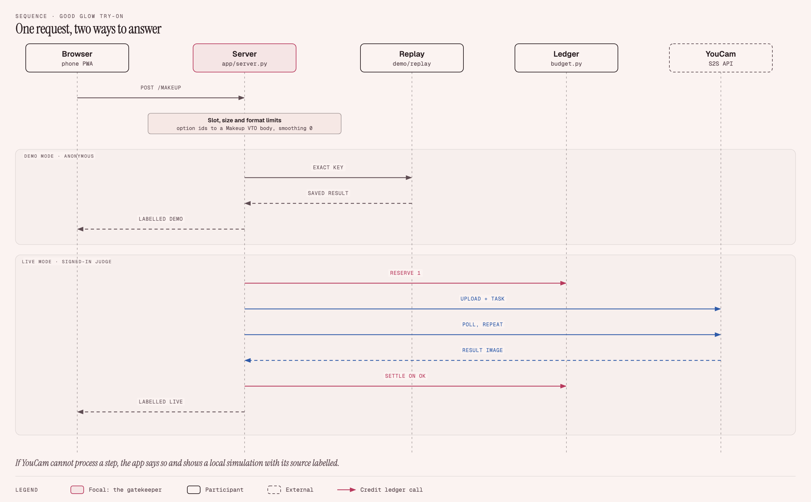

Mermaid source

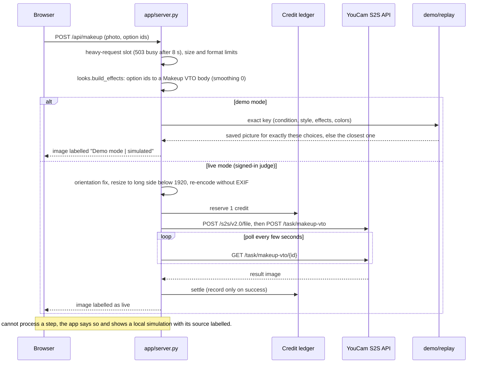

## 5 Skin tone to shade

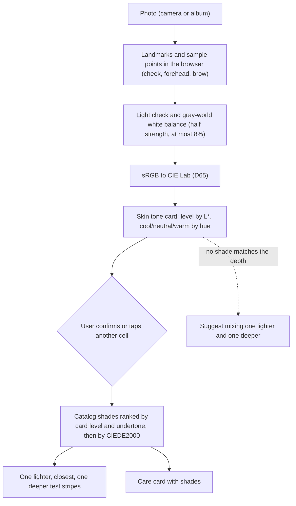

Why a card first: photo colors are pulled grey and pink by light, so comparing them directly with swatches found no close match on our test photo. The card (10 levels by 3 undertones) puts the photo and the swatches on one scale.

## 6 Uneven-tone pipeline

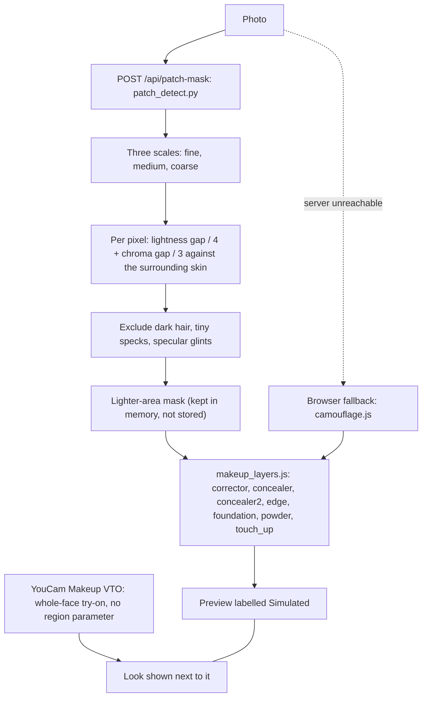

Makeup VTO paints the whole face and has no region parameter, so concealing only one patch is our own local code. The measured comparison is reproducible with `tools/repro_region_gap.py` (section 12).

## 7 Capture and photo checks

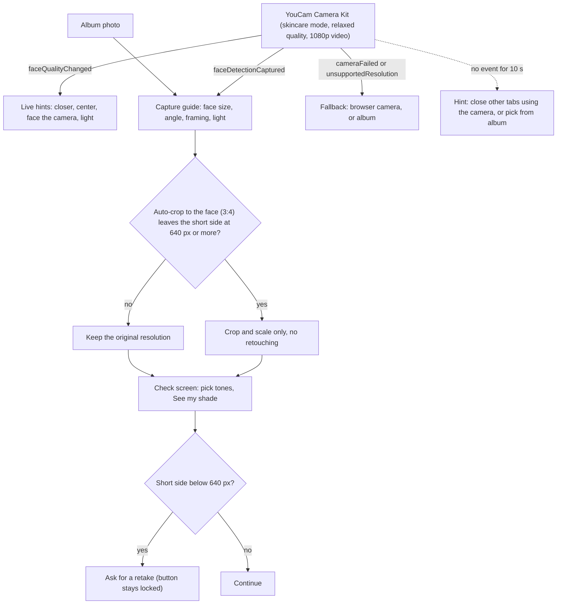

The Camera Kit returns about 680 x 1080 on a phone, so the minimum short side is 640 px (the server enforces the same limit).

## 8 Credit ledger

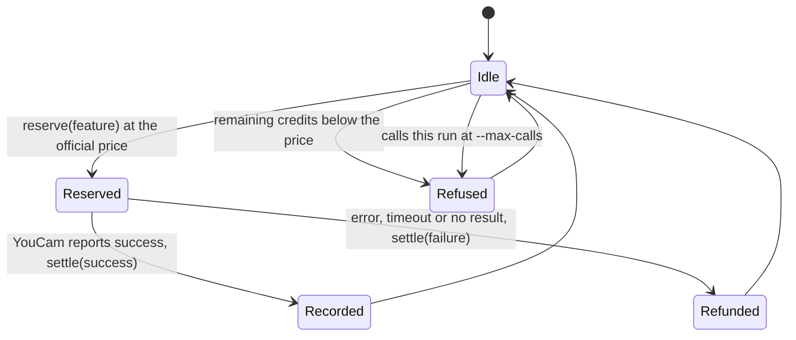

The ledger is `runs/budget_ledger.json` (not in version control; a persistent volume on the hosted site). `--max-calls` limits Makeup VTO calls per start, `--budget-cap` limits credits across starts. Prices: Makeup VTO 1, Face Attribute 10.

## 9 Mapping tables

The app is mostly lookup tables, so each behaviour can be read and tested without a model.

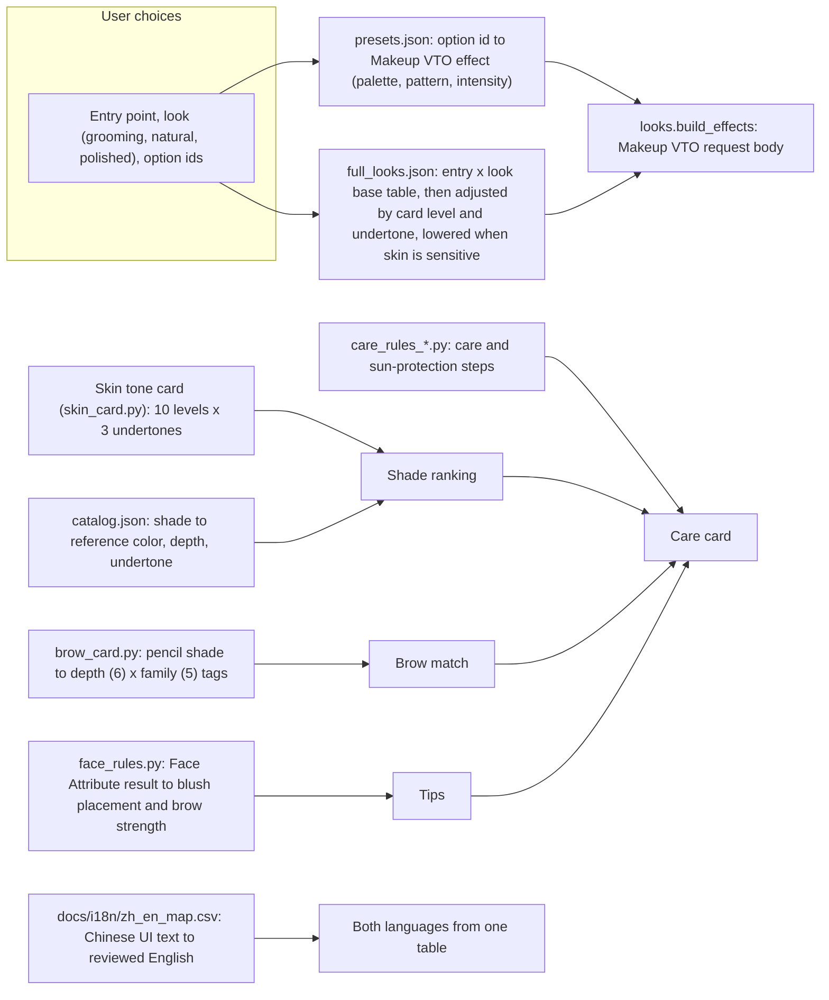

| Table | File | Maps |
|---|---|---|
| Options | `app/presets.json` | option id to a Makeup VTO effect, so the browser never sends free-form parameters |
| Looks | `app/full_looks.json` | entry x look to a base set of options, with a one-sentence reason shown for every adjustment |
| Skin tone card | `app/skin_card.py` | L* bounds to 10 levels, hue to cool/neutral/warm |
| Shades | `app/catalog.json` | fictional demo shades to color, depth, undertone |
| Brows | `app/brow_card.py` | brow product to depth and family tags, matched by tag |
| Face tips | `app/face_rules.py` | Face Attribute output to blush and brow suggestions |
| Translation | `docs/i18n/zh_en_map.csv` | Chinese UI text to reviewed English (section 13) |
| Technique vs simulation | `docs/LAYERS_TECHNIQUE_VS_SIMULATION.md` | each layer to the real technique, our simulation and a verdict (section 10) |

## 10 Real technique vs simulation

We built a mapping table from each makeup layer to how the technique is really done, then read our own code against it to find where the simulation differs. The table is [docs/LAYERS_TECHNIQUE_VS_SIMULATION.md](LAYERS_TECHNIQUE_VS_SIMULATION.md).

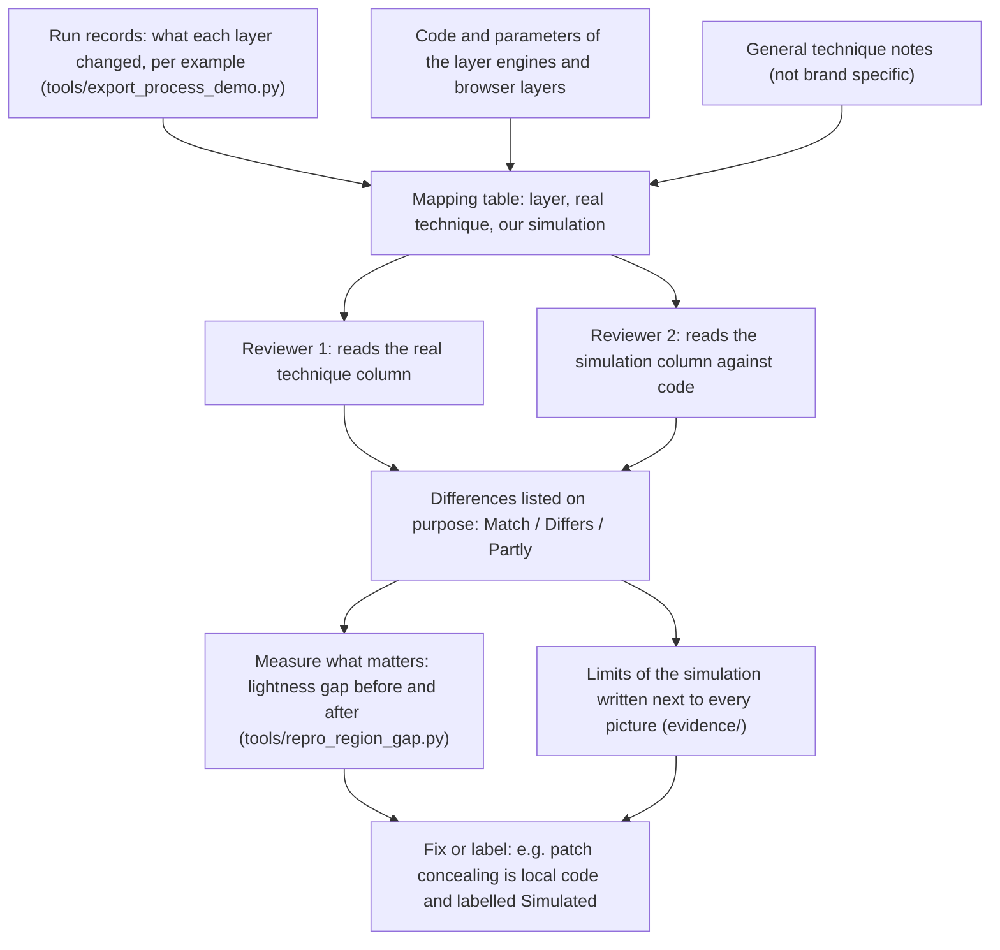

What the comparison found (details in the table):

| Where the simulation differs | Example |
|---|---|
| Order | highlight is applied before blush, real application usually does it last |
| Shape | nose shadow drawn as two vertical lines, real application blends along the sides of the nose |
| Tool | no corrector layer under the eyes, lightness is pulled toward the cheek instead |
| Width | the edge-blending band is far narrower than any width in our notes |
| Function | powder only pushes toward the foundation colour: no shine or oil model |
| Known gap | eyeshadow is one flat colour, real application uses two or three zones |

No physics for oxidation, shine, caking or wear-off; every opacity cap is an upper bound, not the real peak. The offline numbers are not independent tests: the engine was designed to shrink the gap we then measure.

## 11 Local tools

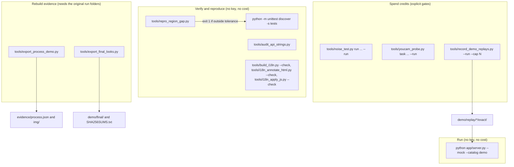

| Tool | What it does | How it works |
|---|---|---|
| `app/server.py` | serves the app, proxies YouCam, mock replay | standard-library HTTP server with bounded connections, streamed statics, per-request state selection |
| `tools/repro_region_gap.py` | the measured comparison | fixed inputs with checksums in `demo/repro/`; patch = inside the mask, surrounding skin = a 14 to 70 px ring outside it with skin-like pixels; prints the table and exits 1 outside tolerance |
| `tools/noise_test.py` | YouCam REST client and offline noise test | upload, task, poll, retry; 12-unit Skin Analysis runs only with `--run`; `check`, `summarize` and `credit` are free |
| `tools/youcam_probe.py` | one request against one feature | dry run by default; `--run` spends the price; request bodies live in `tools/bodies/` |
| `tools/record_demo_replays.py` | records the saved real results used by demo mode | dry run by default; `--run --cap N` spends 1 credit per option combination, ledger-checked |
| `tools/export_process_demo.py`, `tools/export_final_looks.py` | rebuild the evidence page data and the final looks | write `evidence/process.json`, `evidence/img/*`, `demo/final/*` and checksums |
| `tools/build_i18n.py`, `tools/extract_ui_strings.py`, `tools/i18n_annotate_html.py`, `tools/i18n_apply_js.py`, `tools/jslex.py`, `tools/audit_api_strings.py` | translation toolchain (section 13) | table-driven; each has a `--check` mode used by the tests |

Full command reference: [TOOLS_AND_USAGE.md](TOOLS_AND_USAGE.md).

## 12 Evidence pipeline

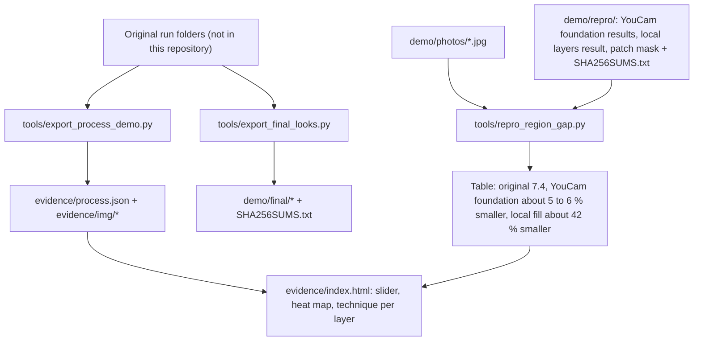

The 42 % is a confirmation, not a blind test: the layers were designed to shrink exactly this gap. One photo, YouCam coverage 80.

## 13 Translation pipeline

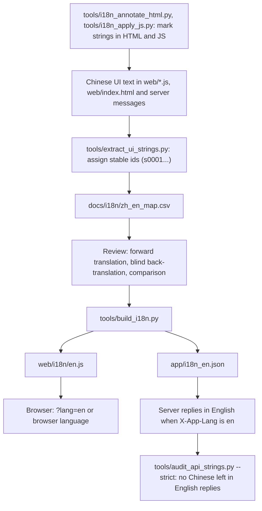

The Chinese output stays byte-identical; tests pin the table's row count and checksum so a drift is caught.

## Rendered images

The same diagrams as image files (SVG and PNG, rendered from the Mermaid sources above), for places that do not render Mermaid.

| # | Diagram | Files |
|---|---|---|
| 0 | System architecture | [SVG](assets/diagrams/00-system-architecture.svg), [PNG](assets/diagrams/00-system-architecture.png) |
| 1 | Context and deployment | [SVG](assets/diagrams/01-context-and-deployment.svg), [PNG](assets/diagrams/01-context-and-deployment.png) |
| 2 | Components | [SVG](assets/diagrams/02-components.svg), [PNG](assets/diagrams/02-components.png) |
| 3 | Operating modes | [SVG](assets/diagrams/03-operating-modes.svg), [PNG](assets/diagrams/03-operating-modes.png) |
| 4 | Try-on request | [SVG](assets/diagrams/04-tryon-request.svg), [PNG](assets/diagrams/04-tryon-request.png) |
| 5 | Skin tone to shade | [SVG](assets/diagrams/05-skin-tone-to-shade.svg), [PNG](assets/diagrams/05-skin-tone-to-shade.png) |
| 6 | Uneven-tone pipeline | [SVG](assets/diagrams/06-uneven-tone-pipeline.svg), [PNG](assets/diagrams/06-uneven-tone-pipeline.png) |
| 7 | Capture and photo checks | [SVG](assets/diagrams/07-capture-and-photo-checks.svg), [PNG](assets/diagrams/07-capture-and-photo-checks.png) |
| 8 | Credit ledger | [SVG](assets/diagrams/08-credit-ledger.svg), [PNG](assets/diagrams/08-credit-ledger.png) |
| 9 | Mapping tables | [SVG](assets/diagrams/09-mapping-tables.svg), [PNG](assets/diagrams/09-mapping-tables.png) |
| 10 | Real technique vs simulation | [SVG](assets/diagrams/10-technique-vs-simulation.svg), [PNG](assets/diagrams/10-technique-vs-simulation.png) |
| 11 | Local tools | [SVG](assets/diagrams/11-local-tools.svg), [PNG](assets/diagrams/11-local-tools.png) |
| 12 | Evidence pipeline | [SVG](assets/diagrams/12-evidence-pipeline.svg), [PNG](assets/diagrams/12-evidence-pipeline.png) |
| 13 | Translation pipeline | [SVG](assets/diagrams/13-translation-pipeline.svg), [PNG](assets/diagrams/13-translation-pipeline.png) |
