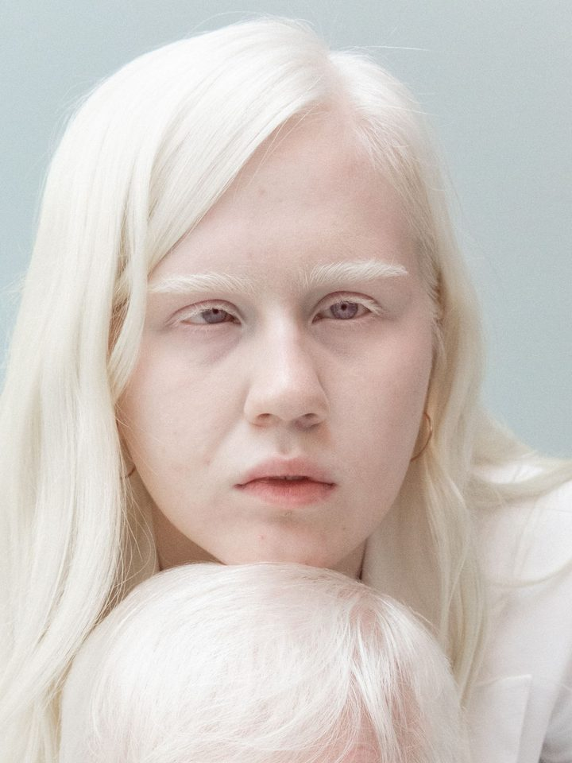
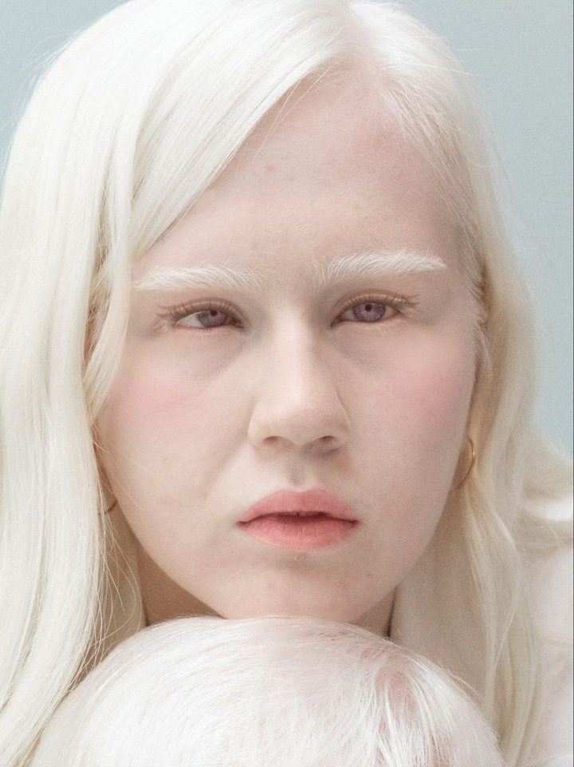
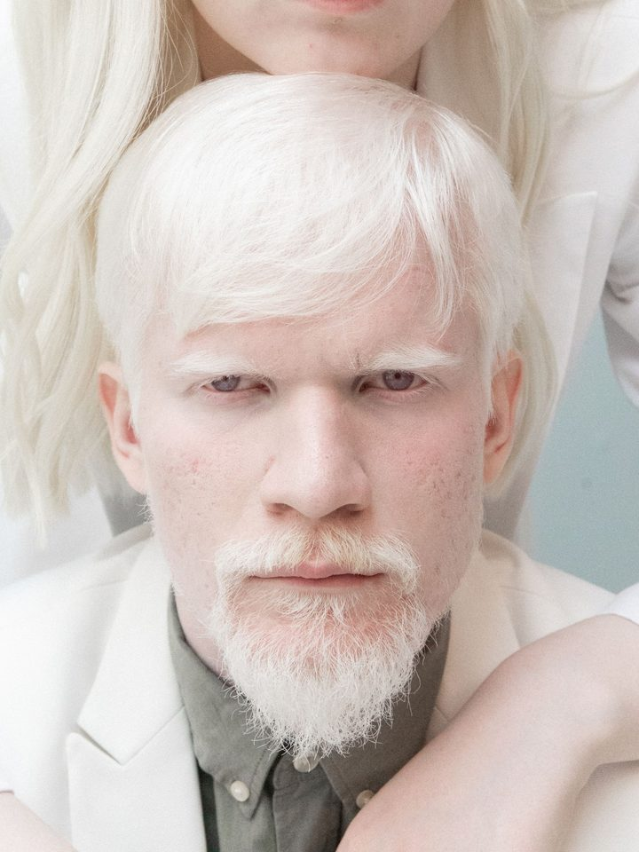
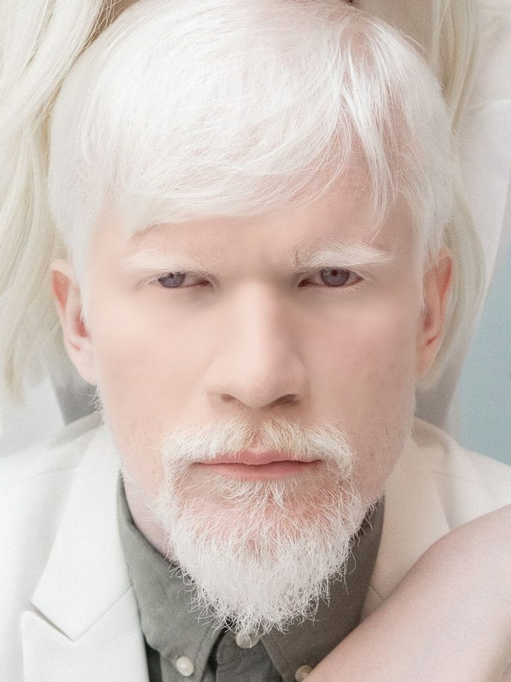
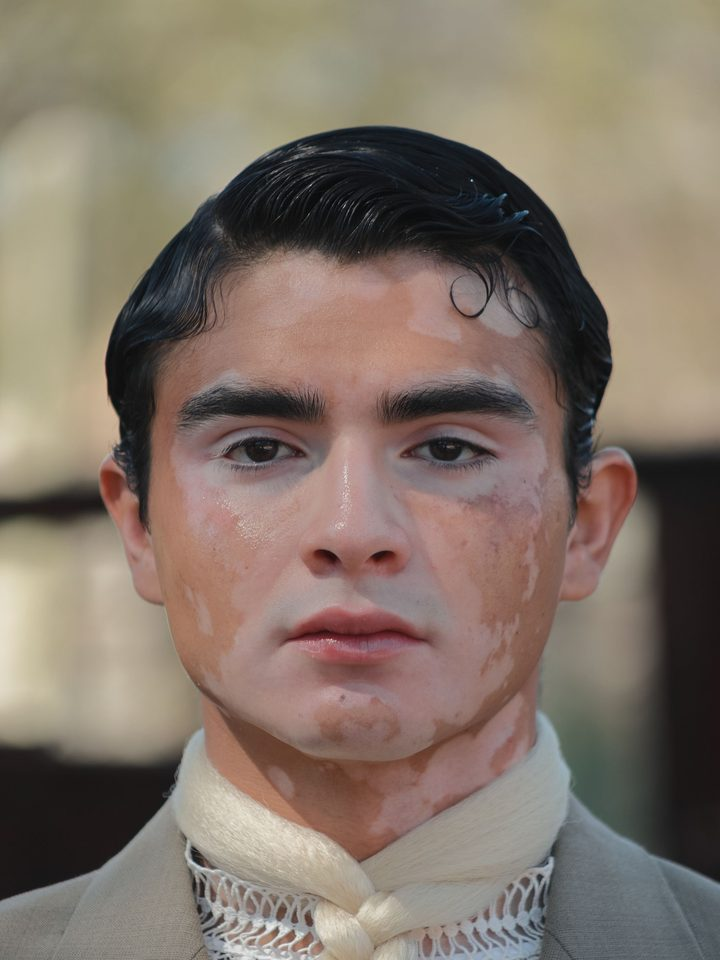
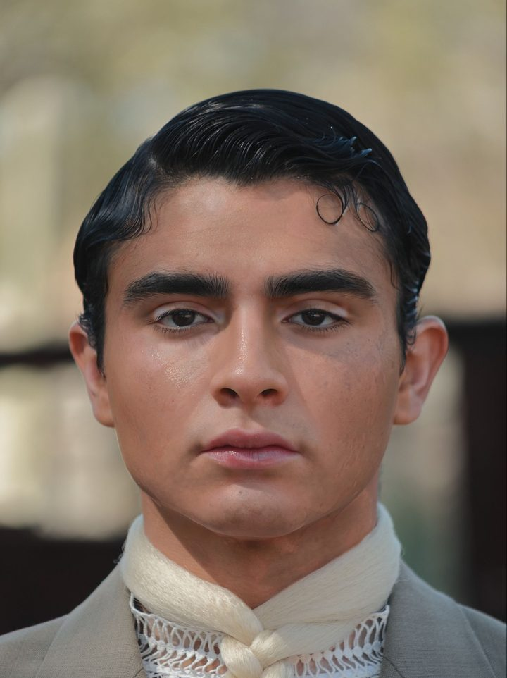
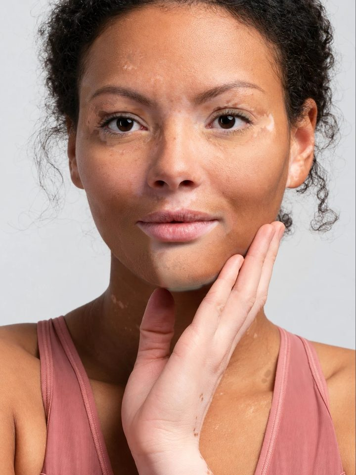

# Evidence: how a look is built, and what we can and cannot show online

This page lives in the repository only. The app itself (`web/`) does not link here and the container image does not include it.

Every image below is **simulated**. The people in these photos did not take part in this project and do not endorse it. Photo sources and licences: [`demo/SOURCES.md`](../demo/SOURCES.md). One example starts from an AI-generated frontal illustration made from a side-view stock photo; it is not the person's original photo.

## Why this page exists

YouCam Makeup VTO paints the whole face and has no region parameter, so it cannot conceal only one lighter patch of skin. Our app adds local code for that step. The layer-by-layer engine that produced the pictures below is too heavy to run live on a public server (about 2 minutes per photo, extra image libraries), so we show the process and the numbers here instead of pretending the online app does it.

| Tier | What | Where |
|---|---|---|
| 1. Try it (online) | Skin tone card, shade ranking, fill preview, simulated local concealing; in demo mode YouCam try-on shows the saved result of a real call for your exact choices when recorded, otherwise the closest | the live demo (URL on the Devpost page) |
| 2. Look at the evidence | Four examples built layer by layer, a heat map of what each layer changed, the comparison table | this page and the interactive viewer: run `python3 -m http.server 8000` in the repository root and open `http://localhost:8000/evidence/` (it does not open from `file://`; GitHub Pages works too) |
| 3. Offline engine | Pre-computed frames; final-look images are checkable with [`demo/final/SHA256SUMS.txt`](../demo/final/SHA256SUMS.txt) | not part of the public online version |

## The measured comparison (reproducible)

Same demo photo, same measure: the lightness gap between a lighter patch and the skin around it. Run `python3 -I -B tools/repro_region_gap.py` (inputs and checksums in [`demo/repro/`](../demo/repro/README.md)).

| | Lightness (L*) gap | Gap shrunk |
|---|---|---|
| Original photo | 7.4 | — |
| YouCam whole-face foundation, dark shade | 6.9 | about 6% |
| YouCam whole-face foundation, light shade | 7.0 | about 5% |
| Our layered local fill | 4.3 | about 42% |

This is one photo with YouCam coverage 80, and the 42% is our offline engine; the in-browser layers were not measured. The local layers of that run were fitted to an AI-generated target image and were designed to shrink exactly this gap, so it is a confirmation, not a blind test.

## The four examples

Open the [interactive viewer](index.html) to slide through every step. Start and finish of each:

| Example | Start | Finish (simulated) | Local layers | YouCam steps |
|---|---|---|---|---|
| Very light skin A |  |  | 11 | 1 (blush, on a picture that already carries an earlier YouCam eye-makeup pass) |
| Very light skin B |  |  | 4, plus a labelled soft-focus pass | 1 |
| Uneven skin tone A |  |  | 17 (fitted to an AI-generated target image) | 1 |
| Uneven skin tone B |  |  | stage images only (the per-area intermediates were not kept) | 2 |

## What the simulation does and does not do

- Division of work: in the live app, YouCam Makeup VTO does the whole-face try-on (base, brows, lashes, blush, lips, contour) and only concealing on a single patch is done by our local code. The evidence examples below were built differently: our offline layer engine painted most layers and YouCam added one or two official steps. Every step on the page says which side did it.
- YouCam smoothing is fixed at 0. One final (very light skin B) also has a local soft-focus pass, labelled on the page.
- Per-layer colour change is measured and shown as a heat map. Measured texture kept is 87–99% depending on the example, not 100%.
- Independent recounts of some stage targets (eye area, texture retention) were **not met**; we left them in.
- In the in-app lighter-area editor a second face model (YuNet) is compared with MediaPipe and a warning is shown when they disagree. It is a warning, not a gate, and exists only there.
- No physics for oxidation, shine, caking or wear-off. Opacity caps are upper bounds.

Checksums of every image and of `process.json` on this page: [`SHA256SUMS.txt`](SHA256SUMS.txt) (`cd evidence && shasum -a 256 -c SHA256SUMS.txt`).

Layer-by-layer comparison with real application technique: [`docs/LAYERS_TECHNIQUE_VS_SIMULATION.md`](../docs/LAYERS_TECHNIQUE_VS_SIMULATION.md). Tools and how to run them: [`docs/TOOLS_AND_USAGE.md`](../docs/TOOLS_AND_USAGE.md).
